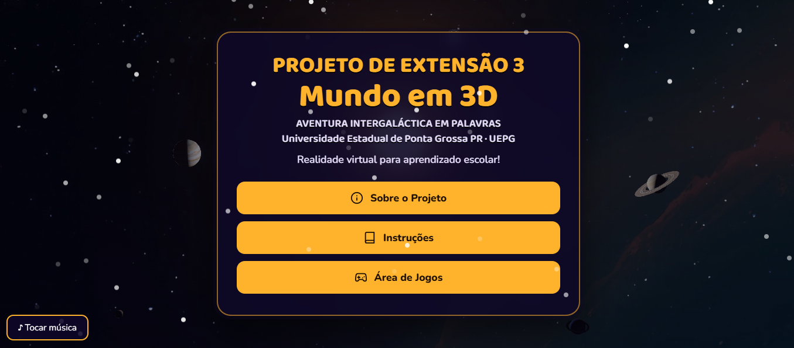
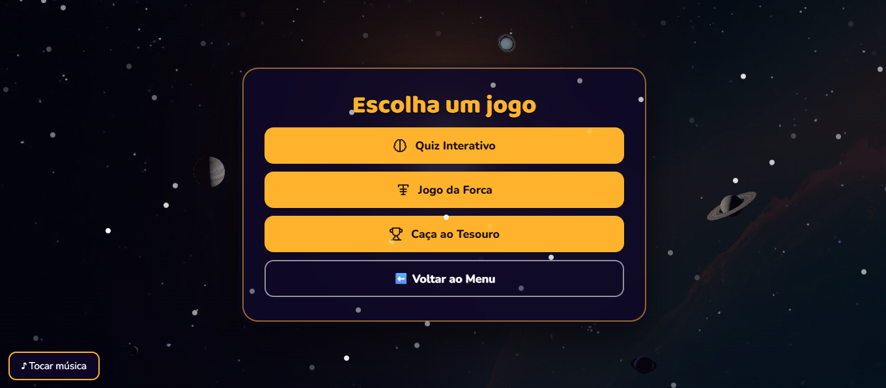
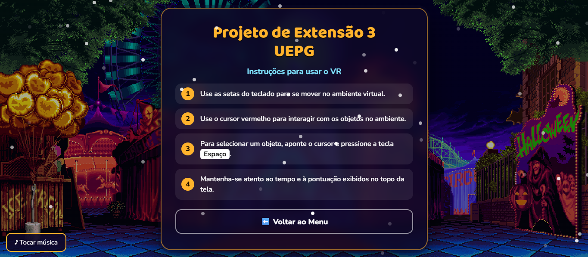
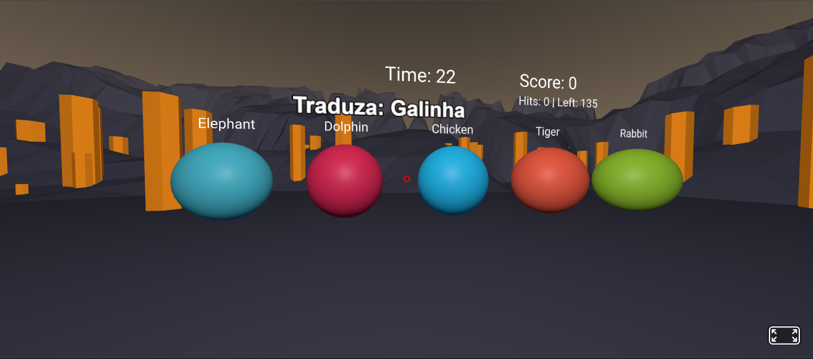
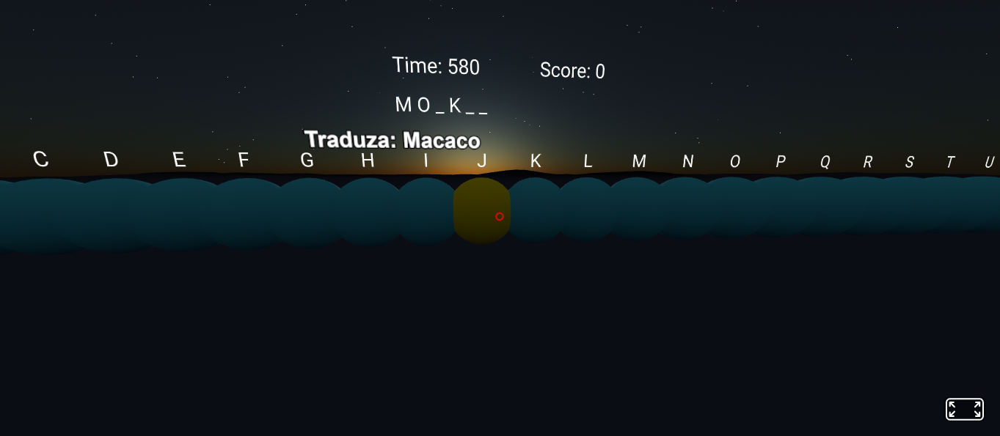
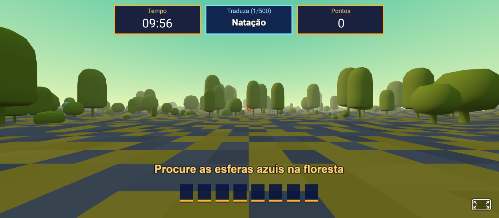

# 🌍 Mundo em 3D: A Aventura em Palavras (UEPG)

Projeto de extensão para a disciplina de Prática Extensionista 3, realizado no ano de 2024, do curso de **Engenharia de Software da Universidade Estadual de Ponta Grossa (UEPG)**, no Paraná. O objetivo principal é explorar o potencial da Realidade Virtual (VR) como ferramenta pedagógica para enriquecer o processo de ensino-aprendizagem de inglês em escolas da região.

O projeto utiliza tecnologias web (HTML, CSS, JS e o framework **A-Frame**) para criar uma experiência imersiva e acessível diretamente pelo navegador, sem a necessidade de instalar aplicativos ou possuir óculos de VR (embora seja compatível com eles).

## 🎮 Os 3 Jogos

O projeto conta com um menu inicial em 2D e uma "Área de Jogos" com três experiências em Realidade Virtual:

### 1. 🏆 Caça ao Tesouro 3D
- **Cenário:** Floresta.
- **Objetivo:** Traduzir a palavra em português exibida no HUD e encontrar as letras certas espalhadas pelo cenário 3D.
- **Mecânica:** O jogador tem 10 minutos para completar as palavras. Use o cursor para apontar para as esferas azuis e aperte **ESPAÇO** para confirmar a letra. O progresso é mostrado no quadro de letras abaixo do HUD.

### 2. 🔤 Jogo da Forca
- **Cenário:** Céu estrelado.
- **Objetivo:** Adivinhar a tradução correta da palavra em português antes que as 6 chances acabem.
- **Mecânica:** O alfabeto completo (A-Z) está flutuando na cena. Aponte o cursor para uma letra e aperte **ESPAÇO** para tentar. O jogo tem um tempo total de 10 minutos. Pontos são ganhos com base nas chances restantes.

### 3. 🧠 Quiz Interativo
- **Cenário:** Mina de Ouro.
- **Objetivo:** Escolher a tradução correta entre 5 opções de esferas coloridas.
- **Mecânica:** O jogador tem 30 segundos por palavra e 3 chances de erro. Acertos valem 10 pontos. O HUD exibe o Tempo, Score e o contador de Acertos/Faltam.

## 🛠️ Tecnologias Utilizadas

- **[A-Frame (v1.6.0)](https://aframe.io/):** Framework web para construção das cenas 3D.
- **[A-Frame Environment Component](https://github.com/supermedium/aframe-environment-component):** Utilizado para gerar os cenários de fundo (Floresta, Mina de Ouro e Céu Estrelado).
- **HTML5 Canvas & JavaScript:** Utilizados para renderizar o texto de forma nítida na cena 3D, garantindo o suporte correto a acentos (ç, ã, etc.), já que as fontes padrão do A-Frame não suportam todos os caracteres.
- **CSS3:** Estilização do menu principal, instruções e página "Sobre".

## 🖼️ Capturas de Tela

### Menu Principal


### Área dos Jogos


### Instruções dos Jogos


### Quiz Interativo


### Jogo da Forca


### Caça ao Tesouro



## 📁 Estrutura do Projeto

```text
mundoem3d/
│
├── index.html          # Menu inicial, tela de instruções e tela "Sobre"
├── quiz.html           # Jogo do Quiz Interativo
├── forca.html          # Jogo da Forca
├── caca_tesouro.html   # Jogo do Caça ao Tesouro
│
├── css/
│   └── style.css       # Estilos do menu e das telas de interface
│
├── js/
│   └── script.js       # Lógica do menu e controle da música de fundo
│
└── audio/
    └── background-music.mp3 # Música de fundo do menu
```
# Acesso Online
### O projeto está hospedado e publicado via GitHub Pages e pode ser jogado diretamente pelo navegador.
🌍 Link: [https://micheldelima.github.io/mundoem3d/](https://micheldelima.github.io/mundoem3d)

# Clone este repositório:
### git clone https://github.com/micheldelima/mundoem3d.git

# 👨‍💻 Autores do projeto
### Michel de Lima
### Carolina Picheictt Carvalho Gomes
### Ano/Série: 2º ano / Projeto de Extensão 3 - Engenharia de Software - UEPG (2024)

